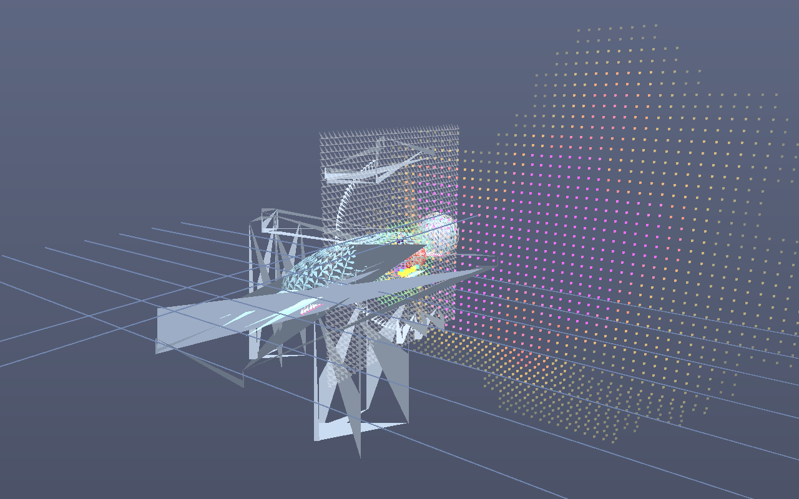

# angio-visu

Interaktive **3D-Visualisierung einer Angio-Intervention** (Koronarintervention) mit einer
**realistischen Simulation der Dosisverteilung während der Durchleuchtung**.

Educational / Demo — keine medizinische Anwendung, keine klinischen Dosiswerte.



Vorschau direkt neben `index.html` im Repo-Root: **[preview.png](preview.png)**.
`assets/` ist als leeres Verzeichnis für künftige Dateien angelegt.

`preview.png` wird ohne Browser aus der echten Szenengeometrie + Dosis-Simulation
software-gerendert: `npm run update:preview` (RAO 25°, kranial −10°, Katheter 85 %,
Kontrast in der LAD, Hochdosis-Cine 5 min → Ka,r ≈ 2,0 Gy, Peak Skin ≈ 1,2 Gy).
**Bei jeder Änderung an der Visualisierung mit `npm run update:preview` aktualisieren**
(CI prüft, dass `preview.png` aktuell ist).

## Features

- 3D-Szene: **wassergefüllter Modellkörper** (hellblau, halbtransparent) auf dem Kathetertisch,
  darin schematisch und **per Checkbox schaltbar**: Organe (Lunge/Leber/Magen/Herz), Knochen
  (Wirbelsäule + **Schädel-Schale** aus Knochenmaterial, transparent), **Gehirn** (scheint durch
  die Schädel-Schale). Physik: Torso/Kopf = Wasser (µ=1), Schädel-Schale = Knochen (µ≈1,9·µ_Wasser)
- Tisch: **7 cm wasseräquivalente Platte** (realistisch für Carbon-Tischplatte + Auflage; Frage
  nach Modellkörper: Carbon ~geringe Schwächung, mit Polster zusammen wenige cm wasseräquivalent —
  hier 7 cm angesetzt). Unter-Tisch-Röhre: Strahl geht zuerst durch die Tischplatte (attenuiert)
- **Tisch + Patient verfahrbar**: Slider längs (z, ±80 cm) und quer (x, ±30 cm) sowie per
  Maus-Drag auf die Tischplatte in deren Ebene (quer ±30 cm, längs bis Sockel-Ende — der Sockel
  bleibt stehen). C-Bogen/Isozentrum bleiben stehen → SSD/Dosis ändern sich realistisch
- C-Bogen mit **Unter-Tisch-Röhre** (Quelle unten, Flächendetektor oben — wie im HKL und in
  der Neuro real üblich), Strahlenkegel; **während der Kollimations-Änderung heller Lichtstrahl**
- Aorta + Koronargefäße (LM/LAD, LCX, RCA), Strahlenkegel
- **Umschaltung HKL-Angio ↔ Neuro-Angio** (femoraler vs. radialer Zugang): Katheterpfad,
  Gefäßbaum (Koronarien ↔ Karotis-/Vertebralisbaum) und Isozentrum/C-Bogen-Position (Kopf)
  werden angepasst; Dosis wird zurückgesetzt
- Intervention: Katheter/Guidewire-Vorschub vom femoralen Zugang zum Koronarostium,
  Kontrastmittel-Injektion in die Koronararterie
- C-Bogen: LAO/RAO und kranial/kaudal verstellbar, Tischhöhe und Kollimation einstellbar
- Dosis-Simulation (physikalisch motiviert):
  - Röntgenoutput `Y(kVp) ≈ 45 µGy/mAs @ 1 m · (kVp/80)^2.6`
  - gepulste Durchleuchtung (mA, Pulsbreite, Bildrate), Cine mit erhöhtem mAs
  - Abstandsquadratgesetz (SSD), Rückstreufaktor, Kollimation/Randabfall
  - Schwächung im Patienten über µ(E_eff) von Wasser (E_eff ≈ 0,45·kVp)
  - kumulative **Hautdosis-Verteilung** als 3D-Heatmap auf der Patientenhaut
    plus 2D-Hautdosis-Karte (dorsal) und Dosis-Schnittebene im Isozentrum
  - Monitorgrößen: Ka,r (kumulativ, IRP 15 cm vom Isozentrum), DAP (Gy·cm²),
    Peak Skin Dose mit Schwellen (2 Gy / 5 Gy), Dosisrate, SSD, Feldgröße
  - Dosisverlauf als Zeitplot (Dosisrate + kumulatives Ka,r + **DAP Gy·cm²** gestrichelt;
    DAP akkumuliert steht direkt unter dem Plot, Panel mittig unten)
- **Dosisfeld im Raum (CT-Koordinatensystem)**: akkumuliertes 3D-Voxelraster (44³ um das
  Isozentrum). Daraus zwei Ansichten:
  - **verschiebbare weiße Schnittebene** (Frontal x / Sagittal z / Axial y), Standardpositionen
    exakt durch Patientenachse bzw. Isozentrum („Frontal Mitte", „Sagittal Iso", „Axial Iso"),
    Verschiebung per Slider immer relativ zum Isozentrum im CT-System — unabhängig von Kamera
    und C-Bogen. Farbskala auf der Ebene: **Grün → Gelb → Rot → Violett → fast Schwarz**
  - **Dosiswolke** als **diffuses, additiv geblendetes Volumen** (keine harten Kugeln) im ganzen
    Raum (Voxelraster 4 m, Streu-Reichweite ~2,2 m); Opazität nimmt mit der Dosis zu
  - **Ebene: konstante Opazität** (deckend weiß bzw. Farbe), keine Transparenzabstufung
  - **Umschaltknöpfe Dosis (µSv) / Dosisleistung (mSv/h)**
  - **Farbskala direkt auf der Ebene** eingezeichnet (Balken unten auf der Ebene mit Min/Max + Einheit)
  - Ebene mit **dünnem festen Metergrid** (10-cm-Linien, 50-cm-Hauptlinien) und **1-m-Scalebar rechts
    unten am unteren Bildrand, mittig zwischen zwei Gridlinien, mit Pfeilspitzen**
  - **umschaltbare Farbskala** (Ebene + Wolke): Grün→Gelb→Rot→Violett→Schwarz, Gelb→Orange→Rot→Violett,
    Inferno, Blau→Rot
  - Skala: **Default 0 bis Max auf der Ebene** (auto, je Einheit µSv bzw. mSv/h); rechts im Menü:
    **🔒 Scale-Lock** + **Min**- und **Max**-Eingabefelder (Default 0 / 1000) + **lin/log10-Umschalter**
  - Abstandsabhängigkeit (Unter-Tisch-Röhre, 81 kVp, 20 mA, 15 fps, 30-cm-Feld, lateral):
    **~5 mSv/h @ 1 m, ~0,4–0,6 mSv/h @ 2 m** (≈ 1/d²) — passt zu Literatur:
    „nahe am Patienten einige mSv/h, auch bei einigen Metern noch einige Hundert µSv/h“
    (z. B. asu-arbeitsmedizin.com Strahlenschutz-Durchleuchtung; JSCAI 2025 Phantomstudie:
    meiste Streustrahlung auf der Röhrenseite/unter dem Tisch, Kopfnähe ~4× Bedienposition;
    Augenlinse bis ~20 mSv/h im Cine ohne Deckenschutz — ScienceDirect 2014). Winkelabhängig:
    ~400–600 µSv/h bei 2 m lateral, deutlich weniger hinter Detektor/C-Bogen (Metall-Schatten),
    mehr auf der Röhrenseite; steigt mit kVp (110 kVp etwa Faktor ~2,5 gegenüber 81 kVp)
  - umschaltbar zwischen **akkumulierter Dosis** und **Dosisrate (µSv/h)**
  - die Ebene lässt sich **per Klick + Maus-Ziehen entlang der gewählten Achse (Normalen)**
    verschieben (Position im CT-System relativ zum Isozentrum); Orientierung über
    Select (Frontal/Sagittal/Axial) oder Snap-Buttons
  - **📷 Kamera-Button („Ebene als Bild, neuer Tab")**: rendert die Ebene als PNG in einem
    neuen Tab — mit **Durchstoßungslinie des Nutzstrahls, gefärbt nach durchstoßenem Material**
    (Tisch / Schädelknochen / Weichteil-Wasser), **im Bild eingebetteter Farbskala mit Einheit
    (µSv bzw. µSv/h) und Beschriftung am unteren Rand** (Ebene, Offset, Modus, log/linear)
- **Streu-Modell v2** (Quellen auf Voxel-Materialraster + Ray-Marching-Transport):
  - kV-Schnellwahl (70/81/90/100/110 kV) + Slider 60–120 kVp
  - Streufaktor `SPR(kVp, Feld) = 0.08·(A/100cm²)^0.35·(kVp/80)^1.5` und Rückstreufaktor
    `BSF = 1 + min(0.5, 0.25·(A/100)^0.3·(80/kVp)^1.2)` — BSF nimmt mit kVp ab; Anzeige von SPR/BSF im Dosis-Monitor
  - **Materialraster** über den ganzen Raum (4 m um das Isozentrum, Zellgröße wählbar **8/5/4 cm**):
    Luft / Wasser (Patient: Torso, Kopf, Gliedmaßen) / Knochen (Schädelkalotte, µ×1,9) /
    wasseräquivalente Tischplatte / Metall (Röhrengehäuse, Detektor, C-Bogen, Sockel, µ×8)
  - **Streuquellen**: der Nutzstrahl wird als **Fan** ( divergierende Strahlen von der Quelle durch
    das gesamte Feld am Detektor, Strahlabstand ~ eine Zelle) entlang des ganzen Weges durch das
    Volumen gemarcht; jedes massive Voxel, das ein Strahl kreuzt, wird Quelle mit Leistung
    `Primär(t) · SPR · Feldfläche · Zelle` — also Patientenvolumen (volle sichtbare Ausdehnung),
    Tisch, Röhrengehäuse und Detektor. **Oberflächen-Voxel** (mit Luft-Nachbar = Austrittsfläche)
    werden ×1,5 verstärkt, Metall ×2,5
  - **Transport**: von jeder Quelle Fibonacci-Strahlen (96/128 Richtungen) bis 3 m; aufsummiert wird
    `Leistung · exp(−µ_s · Weg) / (4πd²)` mit µ_s = µ_Wasser(0,45·kVp) × Materialskalierung entlang
    des Wegs (in Luft reines 1/d², in Metall stark abgeschattet → Schatten hinter Detektor/C-Bogen,
    Abschwächung durch Patient/Schädel auf dem Streuweg); Ablage auf einem 2× gröberen
    Streu-Raster + 3 Glättungspässe + Lückenfüllung (diffuse Wolke ohne Löcher/Hotspot-Linie
    entlang des Nutzstrahls; Nahfeld via dMin abgeweicht)
  - **Kalibrierung**: Normierung auf **~5 mSv/h bei 1 m lateral** (81 kVp, 20 mA, 15 fps, 30-cm-Feld),
    linear skaliert mit `Y(kVp)·mAs·fps` → ~1/d² mit Abstand, bei 2 m einige 100 µSv/h
  - Dosisfeld deckt den ganzen Raum ab; Primär (im Strahlkegel) und Streuung akkumulieren getrennt
    (`data` = Dosis, `scatterRate` = Dosisleistung)
  - Hautdosis: Eintritt = Primär × BSF (Rückstreuung zur Quelle) + Streuanteil aus dem Raumfeld;
    Ka,r am IRP inkl. Streuanteil
  - **Zur Library-Frage (FEM/Octree mit variabler Zellgröße 30/15/5/1 cm):** es gibt keine reife,
    getestete JS-Bibliothek für Röntgen-Streutransport. Goldstandard sind C++/Java/Python-Werkzeuge
    (Geant4, MCNP, SpekCalc/SpekPy) — als Web-App zu schwer. Implementiert ist daher ein
    deterministisches Ray-Marching auf einem **uniformen Voxel-Raster** mit wählbarer Zellgröße
    (8/5/4 cm statt adaptiver 30/15/5/1-cm-Zellen; Octree/FEM wäre als Erweiterung möglich).

## Start

```bash
npm install
npm run dev          # Entwicklungsserver
npm run build        # Production-Build nach dist/
npm run build:single # eine einzige, self-contained HTML-Datei: dist/angio-visu.html
npm run preview      # Build lokal ausliefern
```

**Ohne npm/Server direkt im Browser:** die fertige Single-File-App liegt im Repo-Root als
**[angio-visu.html](angio-visu.html)** — Doppelklick genügt (`file://` funktioniert, weil
alles inline ist). Achtung: die Quell-`index.html` allein ist *nicht* per Doppelklick
lauffähig (ES-Modul `/src/main.js` wird über `file://` blockiert) — dafür `angio-visu.html`
oder `npm run dev` verwenden.

## Single-File (eine HTML-Datei)

`npm run build:single` packt den kompletten Build (Three.js + App + CSS) inline in eine
einzige Datei: **`dist/angio-visu.html`**. Diese Datei ist voll interaktiv und lässt sich
direkt per Doppelklick öffnen (`file://`, kein Server nötig) — die 3D-Szene rendert im
WebGL-Canvas, Hautdosis-Karte und Dosisverlauf in 2D-Canvas. In CI wird die Datei jedem
Workflow-Run als Artifact `angio-visu-single-html` angehängt.

## Smoke-Test (optional)

```bash
npx playwright install chromium
npm run preview &      # oder dev-Server
npm run smoke          # prüft Konsole auf Fehler, liest Dosis-Monitor aus, Screenshot
```

## Bedienung

- **Fluoro starten/stoppen**, **Cine**: Dosisakkumulation an/aus
- Dosisstufe (niedrig/mittel/hoch → PulsmA), kVp, Pulsbreite, Bildrate
- LAO/RAO, kranial/kaudal: C-Bogen dreht sich, Dosisverteilung folgt in Echtzeit
- Kollimation und Tischhöhe verändern Feldgröße und SSD → Dosis
- Katheter-Vorschub + Kontrast injizieren: Intervention visuell nachvollziehen
- Dosis zurücksetzen: Heatmap und Zähler nullen
- Kamera: linke Maustaste drehen, rechts verschieben, Rad zoomen

## Tech

Vanilla JS + [Three.js](https://threejs.org) (r170) + [Vite](https://vite.dev). Kein Framework.

## Dosismodell (vereinfachend)

- Luftkerma am Punkt: `Ka = Y(kVp) · mAs · (1 m / d)² · BSF`, nur Eintrittsseite (Normalen-Test)
- Ka,r am IRP inkl. Streuanteil (Faktor 1,5 bei Patient im Strahl)
- DAP = Ka(Isozentrum) · Feldfläche am Isozentrum
- Hauttiefe: Ka · exp(−µ·Schichtdicke) entlang jedes Strahls (Ellipsoid-Schnitt)
- Hauttopografie: ~1700 Oberflächenpunkte (Fibonacci-Kugel auf Torso-/Kopf-Ellipsoiden)
