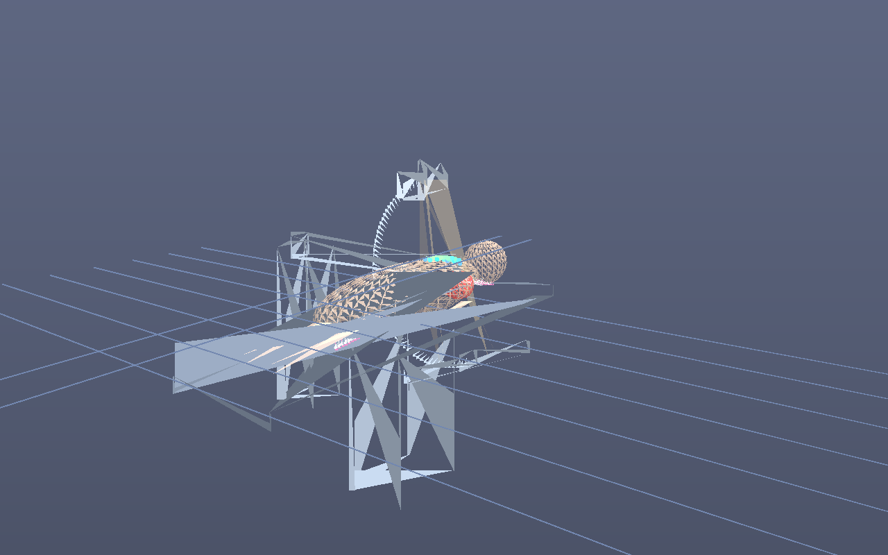

# angio-visu

Interaktive **3D-Visualisierung einer Angio-Intervention** (Koronarintervention) mit einer
**realistischen Simulation der Dosisverteilung während der Durchleuchtung**.

Educational / Demo — keine medizinische Anwendung, keine klinischen Dosiswerte.



Vorschau direkt neben `index.html` im Repo-Root: **[preview.png](preview.png)** (gleiche Datei
auch in `assets/`, plus `assets/preview-ascii.txt` als Text-Version).

`assets/preview.png` wird ohne Browser aus der echten Szenengeometrie + Dosis-Simulation
software-gerendert: `npm run render:preview` (RAO 25°, kranial −10°, Katheter 85 %,
Kontrast in der LAD, Hochdosis-Cine 5 min → Ka,r ≈ 2,0 Gy, Peak Skin ≈ 1,2 Gy).

## Features

- 3D-Szene: Patient auf Kathetertisch, Aorta + Koronargefäße (LM/LAD, LCX, RCA), Herz,
  C-Bogen mit Röntgenquelle und Flächendetektor, Strahlenkegel
- Intervention: Katheter/Guidewire-Vorschub vom femoralen Zugang zum Koronarostium,
  Kontrastmittel-Injektion in die Koronararterie
- C-Bogen: LAO/RAO und kranial/kaudal verstellbar, Tischhöhe und Kollimation einstellbar
- Dosis-Simulation (physikalisch motiviert):
  - Röntgenoutput `Y(kVp) ≈ 45 µGy/mAs @ 1 m · (kVp/80)^2.6`
  - gepulste Durchleuchtung (mA, Pulsbreite, Bildrate), Cine mit erhöhtem mAs
  - Abstandsquadratgesetz (SSD), Rückstreufaktor, Kollimation/Randabfall
  - Schwächung im Patienten über µ(E_eff) von Wasser (E_eff ≈ 0,45·kVp)
  - kumulative **Hautdosis-Verteilung** als 3D-Heatmap auf der Patientenhaut
    plus 2D-Hautdosis-Karte (dorsal) und Dosis-Schnittebene im Isozentrum
  - Monitorgrößen: Ka,r (kumulativ, IRP 15 cm vom Isozentrum), DAP (Gy·cm²),
    Peak Skin Dose mit Schwellen (2 Gy / 5 Gy), Dosisrate, SSD, Feldgröße
  - Dosisverlauf als Zeitplot (Dosisrate + kumulatives Ka,r)

## Start

```bash
npm install
npm run dev          # Entwicklungsserver
npm run build        # Production-Build nach dist/
npm run build:single # eine einzige, self-contained HTML-Datei: dist/angio-visu.html
npm run preview      # Build lokal ausliefern
```

**Ohne npm/Server direkt im Browser:** die fertige Single-File-App liegt im Repo-Root als
**[angio-visu.html](angio-visu.html)** — Doppelklick genügt (`file://` funktioniert, weil
alles inline ist). Achtung: die Quell-`index.html` allein ist *nicht* per Doppelklick
lauffähig (ES-Modul `/src/main.js` wird über `file://` blockiert) — dafür `angio-visu.html`
oder `npm run dev` verwenden.

## Single-File (eine HTML-Datei)

`npm run build:single` packt den kompletten Build (Three.js + App + CSS) inline in eine
einzige Datei: **`dist/angio-visu.html`**. Diese Datei ist voll interaktiv und lässt sich
direkt per Doppelklick öffnen (`file://`, kein Server nötig) — die 3D-Szene rendert im
WebGL-Canvas, Hautdosis-Karte und Dosisverlauf in 2D-Canvas. In CI wird die Datei jedem
Workflow-Run als Artifact `angio-visu-single-html` angehängt.

## Smoke-Test (optional)

```bash
npx playwright install chromium
npm run preview &      # oder dev-Server
npm run smoke          # prüft Konsole auf Fehler, liest Dosis-Monitor aus, Screenshot
```

## Bedienung

- **Fluoro starten/stoppen**, **Cine**: Dosisakkumulation an/aus
- Dosisstufe (niedrig/mittel/hoch → PulsmA), kVp, Pulsbreite, Bildrate
- LAO/RAO, kranial/kaudal: C-Bogen dreht sich, Dosisverteilung folgt in Echtzeit
- Kollimation und Tischhöhe verändern Feldgröße und SSD → Dosis
- Katheter-Vorschub + Kontrast injizieren: Intervention visuell nachvollziehen
- Dosis zurücksetzen: Heatmap und Zähler nullen
- Kamera: linke Maustaste drehen, rechts verschieben, Rad zoomen

## Tech

Vanilla JS + [Three.js](https://threejs.org) (r170) + [Vite](https://vite.dev). Kein Framework.

## Dosismodell (vereinfachend)

- Luftkerma am Punkt: `Ka = Y(kVp) · mAs · (1 m / d)² · BSF`, nur Eintrittsseite (Normalen-Test)
- Ka,r am IRP inkl. Streuanteil (Faktor 1,5 bei Patient im Strahl)
- DAP = Ka(Isozentrum) · Feldfläche am Isozentrum
- Hauttiefe: Ka · exp(−µ·Schichtdicke) entlang jedes Strahls (Ellipsoid-Schnitt)
- Hauttopografie: ~1700 Oberflächenpunkte (Fibonacci-Kugel auf Torso-/Kopf-Ellipsoiden)
